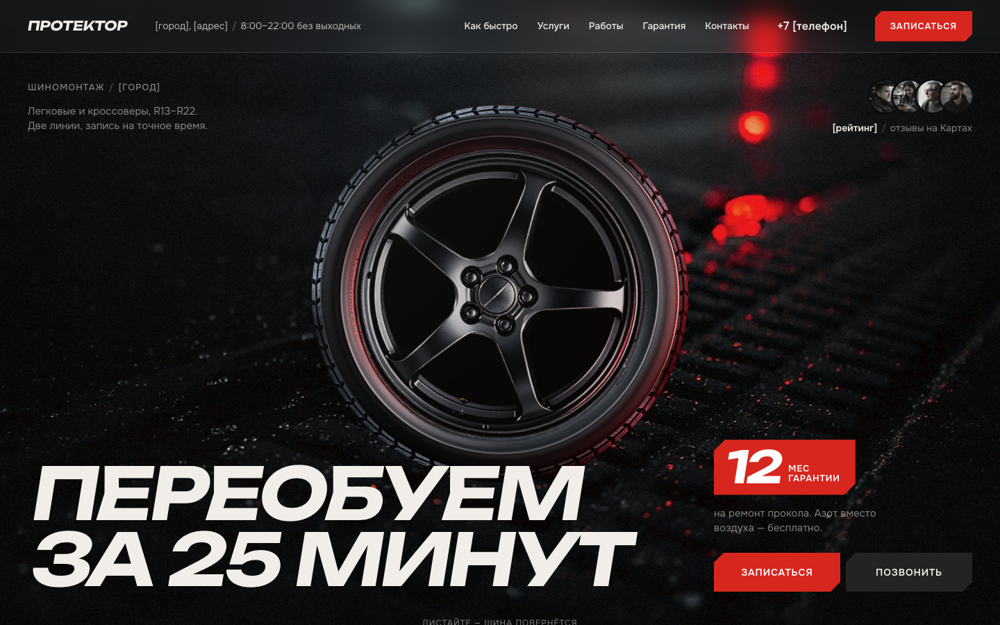
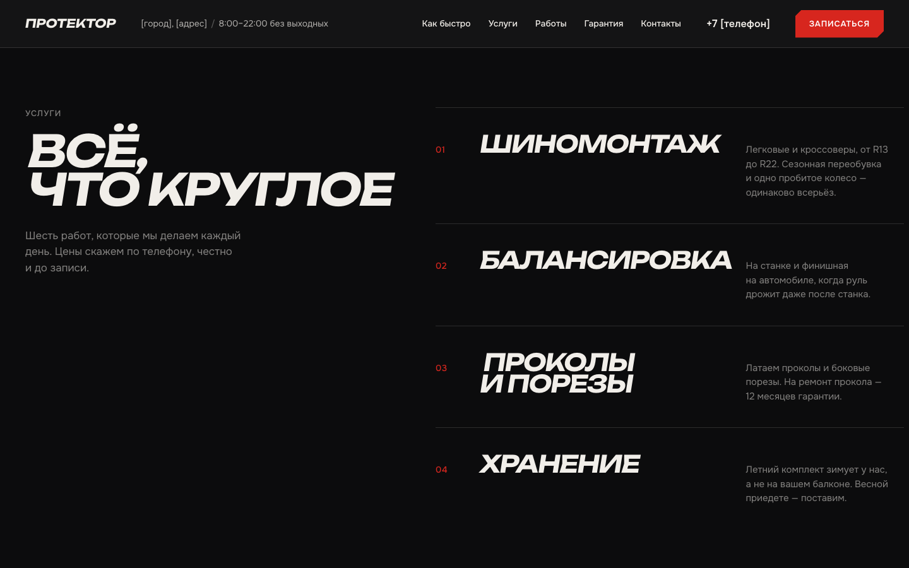
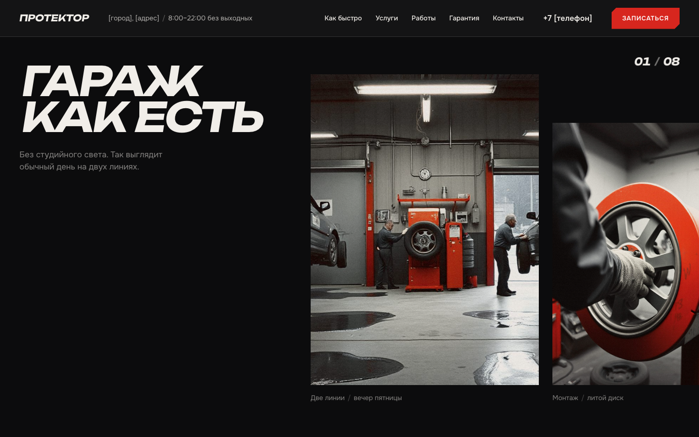
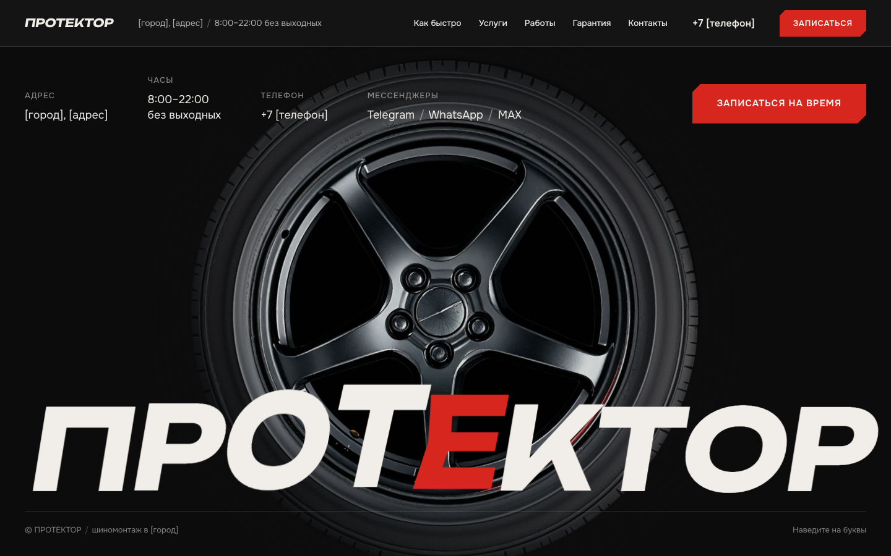

# Араз Наджафов — сайты и автоматизация с ИИ-агентами

Делаю сайты, сервисы и автоматизации с помощью ИИ-агентов (Claude Code): разбираю задачу на шаги, ставлю задачи
агенту, проверяю результат в браузере и довожу до рабочего состояния. Высшее образование по информационным
технологиям (УрГЭУ, 2024).

**Живой сайт портфолио:** открыть `index.html` или страницу GitHub Pages этого репозитория.

---

## 1. «ПРОТЕКТОР» — промо-сайт шиномонтажа уровня Awwwards

Тренировочный сайт по подробному ТЗ: вымышленный шиномонтаж, десктоп 1440 px, без фреймворков
(`index.html` + `styles.css` + `script.js`).

- **3D-шина на three.js**, которая поворачивается и катится при прокрутке. Модель собрана из двух
  сгенерированных текстур (боковина и протектор) на геометрии: кольца с выпуклостью, профиль вращения, утопленный диск.
- **Смена тёмной и светлой темы** по ходу скролла, липкие заголовки, пин-секция «25 минут на всё» со счётчиком.
- **Горизонтальная галерея** от вертикального скролла, параллакс внутри карточек.
- **Футер-финал:** огромный логотип, буквы тянутся к курсору.
- **Все картинки сгенерированы локально** нейросетью FLUX на Mac: шина на чистом фоне для вырезки, фото «снятые между
  делом», единая цветокоррекция серии с одним красным акцентом.
- Правила качества: заголовки без висячих слов, только `transform`/`opacity` в анимациях, кривые
  `cubic-bezier(.22,1,.36,1)` для появления.

Код: папка [`protektor/`](protektor/).

| | |
|---|---|
|  |  |
|  | |

## 2. Конвейер поиска клиентов для веб-студии

Полный цикл «от карты до сообщения владельцу», выстроенный вместе с ИИ-агентом:
1. Выборка бизнесов на Яндекс Картах (небольшие выборки, без массового сбора) и аудит их сайтов скриптами:
   код ответа, мобильная версия, цены, онлайн-запись, битые ссылки.
2. Демо-сайт по реальным данным карточки и отзывов — без выдуманных цифр, цены и фото помечены для владельца.
3. Текст первого сообщения и сценарий звонка: сначала конкретная польза, потом предложение.

Пример: у шиномонтажа с 400+ оценками кнопка «Сайт» вела на захваченный спам-форум — это стало поводом для
предложения. Демо сделано в трёх версиях; показываю по запросу (там данные реального бизнеса).

## 3. Конвейер YouTube-роликов

Сценарий → озвучка → картинки нейросетью → анимация → монтаж → обложка. Два канала, 9+ роликов и 15 шортсов,
разбор статистики в YouTube Studio (CTR, удержание, источники трафика) и план улучшений.

## 4. Сборка сайта по точной спецификации

Промо-страница по спецификации «в числах» (единица макета, координаты, тайминги, кривые, адаптив): один цикл
`requestAnimationFrame` с поправкой на частоту экрана, честный прелоадер, пин-секция с наездом в картинку, одометр,
перемотка видео скроллом, свой сервер с поддержкой Range для видео. Сверка с эталоном на 1440 / 1024 / 768 / 390 px —
расхождение 2–10 px. Исходный набор: [kolobok-site-kit](https://github.com/keizgraphics/kolobok-site-kit).

## 5. База правил для ИИ-агента

Чтобы качество не скакало от проекта к проекту, веду для агента собственные инструкции и правила качества.
Пример: [`ai-agent-quality-rules.md`](ai-agent-quality-rules.md) — типографика, интерфейс, движение, чек-лист приёмки.

---

**Стек:** HTML, CSS, JavaScript, three.js, Python (скрипты), SQL, C#, Claude Code, FLUX.
**Опыт с нейросетями:** ChatGPT с 2022 года, Claude Code с середины 2025 года.
